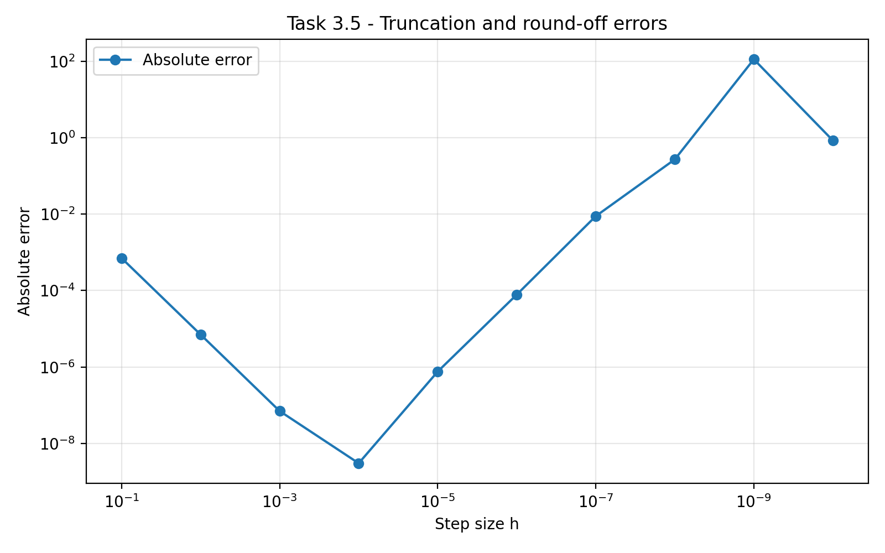

# Solutions - Numerical Methods for the Heat Equation

## Task 3.2 - Second Derivative

### Taylor expansion

For a sufficiently smooth function f:

f(x+h) = f(x) + h f'(x) + h² f''(x)/2
       + h³ f'''(x)/6 + h⁴ f''''(x)/24 + ...

f(x-h) = f(x) - h f'(x) + h² f''(x)/2
       - h³ f'''(x)/6 + h⁴ f''''(x)/24 + ...

Adding the two expansions and subtracting 2f(x):

f(x+h) - 2f(x) + f(x-h)
= h² f''(x) + h⁴ f''''(x)/12 + O(h⁶)

Therefore:

D2 f(x) = [f(x+h) - 2f(x) + f(x-h)] / h²

D2 f(x) = f''(x) + h² f''''(x)/12 + O(h⁴)

The truncation error is h² f''''(x)/12 + O(h⁴), so the
approximation is second-order accurate.

### Numerical verification

For f(x) = sin(x), x = 1: the exact second derivative is -sin(1).

| h | Absolute error |
|---|---|
| 0.1 | 0.0007009921 |
| 0.05 | 0.0001752918 |
| 0.025 | 0.0000438257 |
| 0.0125 | 0.0000109566 |

The error decreases by a factor of about four when h is halved.
Observed order of accuracy: 2.

Experiment: scripts/task_3_2.py
Results: results/task_3_2.txt


## Task 5.2 - Two-Dimensional Update Rule

### Heat equation

du/dt = alpha * (d²u/dx² + d²u/dy²)

Forward Euler in time, centered second differences in space.

### (a) General update, dx and dy different

With r_x = alpha*dt/dx² and r_y = alpha*dt/dy²:

u_new(i,j) = (1 - 2*r_x - 2*r_y) * u_old(i,j)
           + r_x * (u_old(i-1,j) + u_old(i+1,j))
           + r_y * (u_old(i,j-1) + u_old(i,j+1))

### (b) Uniform grid, dx = dy = h

Define r = alpha*dt/h². Then:

u_new(i,j) = (1 - 4r) * u_old(i,j)
           + r * (u_old(i-1,j) + u_old(i+1,j)
                  + u_old(i,j-1) + u_old(i,j+1))

This is the five-point stencil implemented in src/heat.cpp.

### (c) Space-time stencil

```
Level n:                          Level n+1:

            (i,j+1)
               |
  (i-1,j) -- (i,j) -- (i+1,j)  ----->   (i,j)
               |
            (i,j-1)
```

The value at (i,j) at time n+1 depends on the center and its four
neighbors (left, right, up, down) at time n. No diagonal neighbor
is needed.

### (d) Cost of one update

With (1 - 4r) precomputed:

- Reads: 5 old values.
- Write: 1 new value.
- Floating point operations: 4 additions and 2 multiplications,
  that is 6 operations.

Conclusion: an explicit five-point stencil with two separate arrays
(old and new), swapped after each step.


## Task 3.4 - The Discrete Laplacian

(a) d²u/dx² at (x_i, y_j):
    [u(i+1,j) - 2u(i,j) + u(i-1,j)] / dx²

(b) d²u/dy² at (x_i, y_j):
    [u(i,j+1) - 2u(i,j) + u(i,j-1)] / dy²

(c) Adding both:

    Lap_h u(i,j) = [u(i+1,j) - 2u(i,j) + u(i-1,j)] / dx²
                 + [u(i,j+1) - 2u(i,j) + u(i,j-1)] / dy²

    Using Task 3.2, the truncation error is
    (dx²/12) u_xxxx + (dy²/12) u_yyyy + O(dx⁴ + dy⁴),
    that is O(dx² + dy²): second-order accurate.

(d) For dx = dy = h:

    Lap_h u(i,j) = [u(i+1,j) + u(i-1,j) + u(i,j+1) + u(i,j-1)
                    - 4u(i,j)] / h²

(e) Five-point stencil (weights multiplied by 1/h²):

```
                 (i,j+1)  weight 1
                    |
    (i-1,j) -- (i,j) -- (i+1,j)
     weight 1   weight -4   weight 1
                    |
                 (i,j-1)  weight 1
```

The weights add up to 0.

(f) Lap_h u(i,j) = (4/h²) * (average of the 4 neighbors - u(i,j)).
    The mean-value formula (1.2) says
    average over a circle of radius r = u + (r²/4) Lap u,
    so Lap u ≈ (4/r²)(average - u). With r = h and the four
    neighbors as a discrete circle, both formulas give the same
    result: the Laplacian measures how much the average of the
    surroundings exceeds the value at the point.


## Task 5.5 - Accuracy of the Scheme

The scheme is
(u^{n+1}_{ij} - u^n_{ij}) / dt = Lap_h u^n_{ij}.

- Time: forward difference. By Example 3.3 its truncation error is
  (dt/2) u_tt + O(dt²), so p = 1.
- Space: central differences (Task 3.4), error O(dx²) + O(dy²),
  so q = 2.

Therefore tau = O(dt) + O(dx²) + O(dy²), with p = 1 and q = 2.
tau -> 0 as dt, dx, dy -> 0, so the scheme is consistent.


## Task 6.3 - Von Neumann Analysis in 2D

Substitute u^n_{jk} = G^n e^{i(j*theta + k*phi)} into
u^{n+1} = u^n + r_x (delta_x² u^n) + r_y (delta_y² u^n),
with r_x = alpha*dt/dx² and r_y = alpha*dt/dy².

(a) Using e^{i*t} - 2 + e^{-i*t} = -4 sin²(t/2):

    G(theta, phi) = 1 - 4 r_x sin²(theta/2) - 4 r_y sin²(phi/2)

    G is real.

(b) G <= 1 always. The smallest G is at theta = phi = pi
    (checkerboard pattern): G = 1 - 4 r_x - 4 r_y.
    Stability needs G >= -1, that is
    r_x + r_y <= 1/2, or
    dt <= 1 / (2 alpha (1/dx² + 1/dy²)).

(c) For dx = dy = h: r_x = r_y = r, so 2r <= 1/2:

    r <= 1/4

(d) In 1D the bound is r <= 1/2; in 2D it is r <= 1/4.
    Guess for 3D: r <= 1/6 (in d dimensions, r <= 1/(2d)).


## Task 7.1 - Predicting the Order

With r fixed, dt = r*h², so the time error O(dt) = O(h²) and the
space error is O(h²). The overall order in h is 2.


## Task 7.2 - Convergence Study

Verification problem, T = 0.05, r = 0.2
(script: scripts/convergence.py, data: results/convergence.csv,
plot: results/convergence.png).

| N | h | steps | err_inf | err_2,h | p_obs |
|---|---|---|---|---|---|
| 16 | 0.0625 | 64 | 1.6634e-3 | 8.3169e-4 | - |
| 32 | 0.03125 | 256 | 4.1418e-4 | 2.0709e-4 | 2.0058 |
| 64 | 0.015625 | 1024 | 1.0344e-4 | 5.1721e-5 | 2.0014 |
| 128 | 0.0078125 | 4096 | 2.5854e-5 | 1.2927e-5 | 2.0004 |
| 256 | 0.00390625 | 16384 | 6.4631e-6 | 3.2316e-6 | 2.0001 |

(c) The observed orders tend to 2, as predicted in Task 7.1.
Note that err_2,h is about err_inf / 2 in every row: the error is
proportional to sin(pi x) sin(pi y), whose discrete 2-norm is about
1/2, so both norms give the same order.


## Task 8.2 - Surface-to-Volume

N x N grid, P processes.

(a) Strips: each process owns N/P rows. A typical (interior) process
    sends 2 rows and receives 2 rows per step: 2N numbers sent and
    2N received, in 2 messages each way. This does not decrease as
    P grows.

(b) Blocks: P = sqrt(P) x sqrt(P) blocks of (N/sqrt(P))² nodes.
    A typical process sends 4 edges of N/sqrt(P) numbers:
    4N/sqrt(P) numbers sent and as many received, in 4 messages
    each way.

(c) With t_msg = t_s + m*t_w, counting messages one after another:

    T_strips = 2 (t_s + N t_w)
    T_blocks = 4 (t_s + (N/sqrt(P)) t_w)

    Blocks are faster when T_blocks < T_strips, that is when
    t_s < N t_w (1 - 2/sqrt(P)).
    - When t_s is small (bandwidth-dominated), blocks win for P > 4
      (less data: 4N/sqrt(P) < 2N). For P = 4 the volumes are equal.
    - When t_s is very large (latency-dominated), strips win:
      2 messages instead of 4.

(d) Computation per step: about t_c * N²/P per process. For strips:

    T_comm / T_comp = 2 (t_s + N t_w) P / (t_c N²)
                    = 2 P t_s / (t_c N²) + 2 P t_w / (t_c N)

    As N grows with P fixed, the ratio tends to 0 (like 1/N for the
    bandwidth term and 1/N² for the latency term). Over a slow
    network (large t_s), parallelism pays off only for large grids,
    when t_c N²/P is much larger than t_s.
    

## Task 3.1 - The Backward Difference

Define D-f(x) = [f(x) - f(x-h)] / h.

By Taylor's theorem with remainder,

    f(x-h) = f(x) - h f'(x) + (h²/2) f''(ξ),   ξ between x-h and x.

Therefore f(x) - f(x-h) = h f'(x) - (h²/2) f''(ξ), and

    D-f(x) = f'(x) - (h/2) f''(ξ).

Truncation error:

    τ(h) = D-f(x) - f'(x) = -(h/2) f''(ξ) = -(h/2) f''(x) + O(h²).

Since f'' is bounded near x, τ(h) = O(h): the backward difference is
first-order accurate. Its leading error has the opposite sign of the
forward difference error (+(h/2) f''), but the same size.

Numerical check for f(x) = sin x at x = 1, f'(1) = cos 1:

| h | |D-f - f'| | ratio | leading term (h/2)|f''(1)| |
|---|---|---|---|
| 0.1 | 4.114e-2 | - | 4.207e-2 |
| 0.05 | 2.081e-2 | 1.98 | 2.104e-2 |
| 0.025 | 1.046e-2 | 1.99 | 1.052e-2 |
| 0.0125 | 5.245e-3 | 1.99 | 5.259e-3 |

The ratios tend to 2 (observed order log2(ratio) ≈ 1), and the error
matches the leading term (h/2)|f''(1)| = (h/2) sin 1.


## Task 3.3 - Sanity Checks on the Formula

D2 f(x) = [f(x-h) - 2f(x) + f(x+h)] / h²   (from Task 3.2).

(a) Exact values:

- f(x) = 1:   (1 - 2 + 1) / h² = 0.
- f(x) = x:   [(x-h) - 2x + (x+h)] / h² = 0.
- f(x) = x²:  [(x-h)² - 2x² + (x+h)²] / h²
              = [x² - 2xh + h² - 2x² + x² + 2xh + h²] / h²
              = 2h² / h² = 2.

These are exactly f'' for these three functions (0, 0 and 2).
A reasonable approximation of f'' must pass these tests: they are the
simplest functions whose second derivative is known, and the
truncation error of D2 contains only f'''' and higher derivatives,
which vanish for polynomials of degree at most 3. If a formula failed
on them, its error would not tend to 0 as h -> 0 even for trivial
functions, so it would not be consistent. Also, f'' must not change
when a constant or a linear function is added to f.

(b) The coefficients of f(x-h), f(x), f(x+h) are 1/h², -2/h², 1/h².
Their sum is 1 - 2 + 1 = 0. This is the test f = 1 seen in the
coefficients: a constant function has f'' = 0, so the weights must
add up to zero. The formula only measures differences between values,
never their level.

(c) Rewrite

    D2 f(x) = (2/h²) * { [f(x-h) + f(x+h)]/2 - f(x) }.

So D2 f(x) is (2/h²) times the amount by which the average of the two
neighbours exceeds the value at the point. It is positive when f(x) is
below the average of its neighbours (f curves upward) and negative
when it is above. This is the one-dimensional version of the meaning
of the Laplacian in Section 1.4: a point heats up when its
surroundings are on average warmer than it.
## Task 1.1 - Mean-value formula

Let a = r cos(phi) and b = r sin(phi). The two-variable Taylor expansion about (x, y) is

```
u(x+a, y+b) = u + a u_x + b u_y + (1/2)(a^2 u_xx + 2ab u_xy + b^2 u_yy) + O(r^3)
```

Integrate term by term over phi from 0 to 2 pi, using: the integrals of cos(phi),
sin(phi) and cos(phi) sin(phi) are 0, and the integrals of cos^2(phi) and sin^2(phi)
are pi.

- Constant term: 2 pi u.
- First-order terms: r u_x (integral of cos) + r u_y (integral of sin) = 0.
- Second-order terms: (r^2/2)(pi u_xx + 2 u_xy * 0 + pi u_yy) = (pi r^2 / 2) Lap u.

Dividing by 2 pi gives the mean over the circle:

```
mean = u + (r^2 / 4) Lap u + (remainder)
```

The third-order terms also vanish (each changes sign under phi -> phi + pi), so
the remainder is O(r^4), not O(r^3).

## Task 1.2 - Dimensional analysis

(a) [alpha t / L^2] = (m^2/s * s) / m^2 = 1, so the number is dimensionless.

(b) Write tau = alpha^p L^q. Its unit is m^(2p+q) s^(-p). To get seconds we need
p = -1 and then 2p + q = 0, so q = 2: tau = L^2 / alpha, and this is the only
possible combination. Any characteristic time depends only on alpha and L, so its
ratio to tau is a dimensionless number that can depend on nothing else, hence a
constant: every characteristic time is proportional to tau.

For a plate with L = 0.10 m (L^2 = 0.01 m^2):

| Material | alpha (m^2/s) | tau = L^2 / alpha |
|---|---|---|
| Copper | 1.1e-4 | about 91 s (1.5 minutes) |
| Carbon steel | 1.3e-5 | about 769 s (13 minutes) |

This matches intuition: copper equalizes its temperature about 8.5 times faster.
tau is an order of magnitude; the constant factor depends on the geometry.

(c) Let x^ = x/L, y^ = y/L and t^ = alpha t / L^2. By the chain rule,
d/dt = (alpha/L^2) d/dt^, d^2/dx^2 = (1/L^2) d^2/dx^^2 (same in y), so

```
(alpha/L^2) u_t^ = (alpha/L^2) (u_x^x^ + u_y^y^)   =>   u_t^ = u_x^x^ + u_y^y^
```

Neither alpha nor L appears. A solver written for alpha = 1 on the unit square
therefore covers every plate and every material: only the time needs converting,
t^ = alpha t / L^2.

## Task 1.3 - Fourier modes

Let u = sin(m pi x / Lx) sin(n pi y / Ly) exp(-lambda t), with
lambda = alpha pi^2 (m^2/Lx^2 + n^2/Ly^2).

- Time derivative: u_t = -lambda u.
- Space derivatives: u_xx = -(m pi / Lx)^2 u and u_yy = -(n pi / Ly)^2 u.
- Therefore alpha (u_xx + u_yy) = -alpha pi^2 (m^2/Lx^2 + n^2/Ly^2) u = -lambda u = u_t,
  so u satisfies the heat equation (1.1).

Boundary: at x = 0 and x = Lx we get sin(0) = sin(m pi) = 0, and at y = 0 and
y = Ly we get sin(0) = sin(n pi) = 0 (m and n are integers). So u = 0 on all four
edges.

Initial condition: at t = 0 the exponential is 1, so
u(x, y, 0) = sin(m pi x / Lx) sin(n pi y / Ly). This is Case V of the project
(Lx = Ly = 1, m = n = 1).

## Task 2.1 - Taylor expansions

(a) f(x+h) = f + h f' + (h^2/2) f'' + (h^3/6) f''' + (h^4/24) f'''' + O(h^5)

(b) f(x-h) = f - h f' + (h^2/2) f'' - (h^3/6) f''' + (h^4/24) f'''' + O(h^5)

The odd-order terms (h, h^3) change sign, because replacing h by -h gives
(-h)^k = -h^k for odd k and +h^k for even k.

(c) f(x+2h) = f + 2h f' + 2h^2 f'' + (4/3) h^3 f''' + (2/3) h^4 f'''' + O(h^5)

(the coefficients are (2h)^k / k! = 2, 8/6 = 4/3, 16/24 = 2/3)

## Task 5.1 - Warm-up in one dimension

(a) At an interior node x_i, using the formula of Task 3.2 (error O(dx^2)):

```
du_i/dt = alpha (u_{i+1} - 2 u_i + u_{i-1}) / dx^2
```

(b) Forward Euler: (u_i^{n+1} - u_i^n) / dt = alpha (u_{i+1}^n - 2 u_i^n + u_{i-1}^n) / dx^2, so

```
u_i^{n+1} = u_i^n + r (u_{i+1}^n - 2 u_i^n + u_{i-1}^n),   r = alpha dt / dx^2
          = (1 - 2r) u_i^n + r (u_{i+1}^n + u_{i-1}^n)
```

(c) The only dimensionless combination is r = alpha dt / dx^2. It is the quantity
alpha t / L^2 of Task 1.2 with t replaced by dt and L by dx: it compares the time
of one step with the diffusion time across one cell.

## Task 5.4 - Insulated edges in 2D

(a) Left edge x = 0 insulated, the other three edges Dirichlet.

- Unknowns: the nodes (0, j) for j = 1..N-1 are no longer fixed. They are updated
  like interior nodes.
- Ghost nodes: one column i = -1, at rows j = 1..N-1.
- Filling rule: u_x(0, y, t) = 0 gives (u_{1,j} - u_{-1,j}) / (2 dx) = 0, so
  u_{-1,j} = u_{1,j} (mirror). The ghost values are refreshed at every step, before
  the update. The node (0, j) becomes:

```
u_{0,j}^{n+1} = u_{0,j} + r (2 u_{1,j} + u_{0,j+1} + u_{0,j-1} - 4 u_{0,j})
```

(b) Corners.

- Corner between an insulated edge and a Dirichlet edge: the corner belongs to the
  Dirichlet condition, so its value is imposed. It is not an unknown and needs no
  ghost node (the value given to the corner must be fixed in the specification).
- Corner between two insulated edges (for example x = 0 and y = 0): the corner
  (0, 0) is an unknown with two ghost nodes, u_{-1,0} = u_{1,0} and
  u_{0,-1} = u_{0,1}:

```
u_{0,0}^{n+1} = u_{0,0} + r (2 u_{1,0} + 2 u_{0,1} - 4 u_{0,0})
```

  (the 5-point stencil uses no diagonal node.)

(c) Nonzero flux u_x(0, t) = h(t):

```
(u_1 - u_{-1}) / (2 dx) = h(t)   =>   u_{-1} = u_1 - 2 dx h(t)
```

The node x_0 is then updated (forward Euler, h evaluated at t_n):

```
u_0^{n+1} = u_0 + r (u_1 - 2 u_0 + u_{-1})
          = u_0 + r (2 u_1 - 2 u_0 - 2 dx h(t_n))
```

If h = 0 we recover the mirror rule of Example 5.2.

## Task 6.7 - Breaking it on purpose

Experiment: N = 64, case 1, r = 0.2625 (5% above the limit 1/4), 200 steps; control run with r = 0.24.
Code: tools/unstable_demo.cpp. Figure: results/unstable/instability.png.

Observation. With r = 0.24 the interior maximum stays at about 1. With r = 0.2625 it stays below 1 for about 110 steps, then grows: 1.5 at step 130, 11 at step 160, about 300 at step 200.

Where it appears. Near the four corners (around i, j = 10 and 55), where the hot edges meet the cold interior: the initial data is discontinuous there, so it contains the most high-frequency content.

Pattern. A checkerboard: the sign alternates from node to node (zoom and 1D cut in the figure).

Link with Task 6.3. The worst Fourier mode has theta = phi = pi, i.e. (-1)^(i+j), with amplification factor G = 1 - 8r. For r = 0.2625, G = -1.1, so |G| > 1: every step multiplies this mode by about 1.1 and flips its sign, which is the growing checkerboard. For r <= 1/4, |G| <= 1 and the mode no longer grows. The measured growth (about 1.09 per step) is slightly below 1.1 because on a 64-point grid the fastest mode is not exactly theta = pi.


## Task 3.5 - Where does round-off take over?

### Numerical experiment

Using the centered second derivative from Task 3.2:

D2 f(x) = [f(x+h) - 2f(x) + f(x-h)] / h²

For f(x) = sin(x) at x = 1, the exact value is -sin(1).

| h | Absolute error |
|---|---|
| 1e-1 | 7.009921e-4 |
| 1e-2 | 7.012235e-6 |
| 1e-3 | 7.008259e-8 |
| 1e-4 | 3.025119e-9 |
| 1e-5 | 7.579768e-7 |
| 1e-6 | 7.806786e-5 |
| 1e-7 | 8.803716e-3 |
| 1e-8 | 2.687520e-1 |
| 1e-9 | 1.118638e+2 |
| 1e-10 | 8.414710e-1 |

The smallest observed error occurs at h = 1e-4.

### Explanation

The truncation error is O(h²), while the round-off
error behaves approximately as O(epsilon/h²).

The total error can therefore be modeled as:

E(h) = C1*h² + C2*epsilon/h²

Balancing the two terms gives:

h² ~ epsilon/h²
h^4 ~ epsilon
h ~ epsilon^(1/4)

For double precision, epsilon is approximately 1e-16.
Therefore, the expected optimal scale is h ~ 1e-4,
which agrees with the numerical experiment.

For smaller h, cancellation and floating-point rounding
errors are amplified by division by h². The errors
need not increase monotonically because rounding
depends on the individual floating-point operations.

Experiment: scripts/task_3_5.py
Results: results/p2/task_3_5.csv




## Task 4.1 - Experiments with forward Euler

### (a) Forward Euler implementation

Consider the initial value problem:

u' = -lambda*u, u(0) = 1, lambda = 50.

The exact solution is:

u(t) = exp(-50*t)

Forward Euler gives:

u_new = u_old - lambda*dt*u_old
      = (1 - lambda*dt)*u_old

The amplification factor is g = 1 - lambda*dt.

### (b) Stability experiment

Stability requires:

|1 - lambda*dt| <= 1

Therefore:

0 < dt <= 2/lambda = 0.04

Experimental results:

| dt | Maximum absolute value | Bounded |
|---|---|---|
| 0.01 | 1.000000 | Yes |
| 0.02 | 1.000000 | Yes |
| 0.03846154 | 1.000000 | Yes |
| 0.04 | 1.000000 | Yes |
| 0.04166667 | 6.827953 | No |
| 0.05 | 3325.257 | No |
| 0.10 | 1048576 | No |
| 0.50 | 576 | No |
| 1.00 | 49 | No |

The largest stable time step observed is dt = 0.04,
in agreement with the theoretical stability limit.

At dt = 0.04, g = -1: the solution remains bounded
but oscillates without decay. This is marginal stability.

### (c) First-order convergence

The absolute error is measured at t = 1 against exp(-50).

| dt | Absolute error | Observed order |
|---|---|---|
| 1e-4 | 2.27345818e-23 | - |
| 5e-5 | 1.17046129e-23 | 0.957811 |
| 2.5e-5 | 5.93901219e-24 | 0.978782 |
| 1.25e-5 | 2.99148628e-24 | 0.989361 |
| 6.25e-6 | 1.50127660e-24 | 0.994673 |

The observed order is calculated using:

p = log(E(dt)/E(dt/2))/log(2)

As dt decreases, the observed order approaches 1.
This confirms first-order global convergence.

### (d) Backward Euler implementation

Backward Euler gives:

u_new = u_old - lambda*dt*u_new

Rearranging:

u_new = u_old/(1 + lambda*dt)

The amplification factor is:

g = 1/(1 + lambda*dt)

For every dt > 0, we have 0 < g < 1.

All tested time steps, including dt = 1, remained
bounded. The maximum absolute value was 1 in every
experiment, including the initial value.

Backward Euler is therefore unconditionally stable
for this problem. Stability does not guarantee
accuracy for large time steps.

Experiment: scripts/task_4_1.py
Results: results/p2/task_4_1_stability.csv
Results: results/p2/task_4_1_convergence.csv


## Task 5.3 - Interpreting the update

### Weighted form of the update

From Task 5.2(b), the explicit scheme on a uniform
grid is:

u_new(i,j) = (1 - 4r)*u_old(i,j)
           + r*(u_old(i-1,j) + u_old(i+1,j)
               + u_old(i,j-1) + u_old(i,j+1))

The central weight is w0 = 1 - 4r.

Each of the four neighboring nodes has weight r.

### (a) Sum of the weights

The sum of all five weights is:

w0 + 4r = (1 - 4r) + 4r = 1

Suppose the temperature is uniform and equal to C,
including compatible boundary values.

Then:

u_new(i,j) = (1 - 4r)*C + 4r*C
           = C

Therefore, a uniform temperature remains unchanged
at every time step.

A constant temperature field is an equilibrium
solution because its spatial Laplacian is zero.

### (b) Physical interpretation

Define the average temperature of the four neighbors:

A = (u_left + u_right + u_top + u_bottom)/4

The update can be rewritten as:

u_new = u_old + 4r*(A - u_old)

The discrete Laplacian measures the difference between
the central temperature and the average temperature
of its four neighbors.

If the central node is hotter than its neighbors on
average, its temperature decreases.

If the central node is colder than its neighbors on
average, its temperature increases.

If the central temperature equals the neighboring
average, its temperature remains unchanged.

For 0 <= r <= 1/4, all five weights are non-negative
and their sum is one. The update is therefore a
convex combination of the old temperatures.

This describes the smoothing effect of heat diffusion
and explains why local temperature differences tend
to decrease over time.


## Task 6.1 - Verify the upwind computation

The amplification factor from Example 6.4 is:

G = 1 - nu + nu*exp(-i*theta)

Its complex conjugate is:

G_bar = 1 - nu + nu*exp(i*theta)

The squared modulus is:

|G|² = G*G_bar

Expanding the product:

|G|² = (1 - nu)² + nu²
       + nu*(1 - nu)*(exp(i*theta) + exp(-i*theta))

Using Euler's identity:

exp(i*theta) + exp(-i*theta) = 2*cos(theta)

Therefore:

|G|² = (1 - nu)² + nu²
       + 2*nu*(1 - nu)*cos(theta)

Using cos(theta) = 1 - 2*sin²(theta/2):

|G|² = (1 - nu)² + nu²
       + 2*nu*(1 - nu)
       - 4*nu*(1 - nu)*sin²(theta/2)

The first three terms simplify to:

(1 - nu)² + nu² + 2*nu*(1 - nu) = 1

Hence:

|G|² = 1 - 4*nu*(1 - nu)*sin²(theta/2)

This verifies the expression in Example 6.4.

For stability, |G|² must not exceed 1 for any theta.

This holds if and only if:

nu*(1 - nu) >= 0

Therefore:

0 <= nu <= 1

Since nu = c*dt/dx, the CFL condition is:

c*dt/dx <= 1

for positive c, dt and dx.


## Task 6.2 - Von Neumann analysis in 1D

### (a) Amplification factor

The explicit 1D heat equation scheme from Task 5.1 is:

u_new(j) = (1 - 2r)*u_old(j)
           + r*(u_old(j-1) + u_old(j+1))

where:

r = alpha*dt/dx²

Consider a discrete Fourier mode:

u(j,n) = G^n * exp(i*j*theta)

Substituting into the numerical scheme and
cancelling the common Fourier factor gives:

G = 1 - 2r + r*exp(-i*theta)
           + r*exp(i*theta)

Using Euler's identity:

exp(i*theta) + exp(-i*theta) = 2*cos(theta)

Therefore:

G = 1 - 2r + 2r*cos(theta)

Using cos(theta) = 1 - 2*sin²(theta/2):

G(theta) = 1 - 4r*sin²(theta/2)

The amplification factor is real because r and
sin²(theta/2) are real.

### (b) Worst-case mode

For r >= 0, since 0 <= sin²(theta/2) <= 1:

1 - 4r <= G(theta) <= 1

At theta = 0, G = 1.

At theta = pi or -pi, G = 1 - 4r.

Consequently:

max |G(theta)| = max(1, |1 - 4r|)

The highest-frequency mode, theta = pi, corresponds
to the alternating grid pattern:

+1, -1, +1, -1, ...

It determines the restrictive stability bound.

For 0 < r < 1/2, the constant mode theta = 0
has the largest absolute amplification factor.

At r = 1/2, both modes have |G| = 1.

For r > 1/2, the alternating mode has |G| > 1
and becomes unstable.

### (c) Stability condition

Von Neumann stability requires:

|G(theta)| <= 1

for every theta.

The restrictive condition is:

1 - 4r >= -1

Therefore:

r <= 1/2

Substituting r = alpha*dt/dx² gives:

alpha*dt/dx² <= 1/2

Hence:

dt <= dx²/(2*alpha)

for positive alpha and dt.

This is the stability condition for the explicit
one-dimensional heat equation scheme.

At the limiting value r = 1/2, the highest-frequency
mode oscillates without decay. Above this limit,
its amplitude grows and the scheme is unstable.
